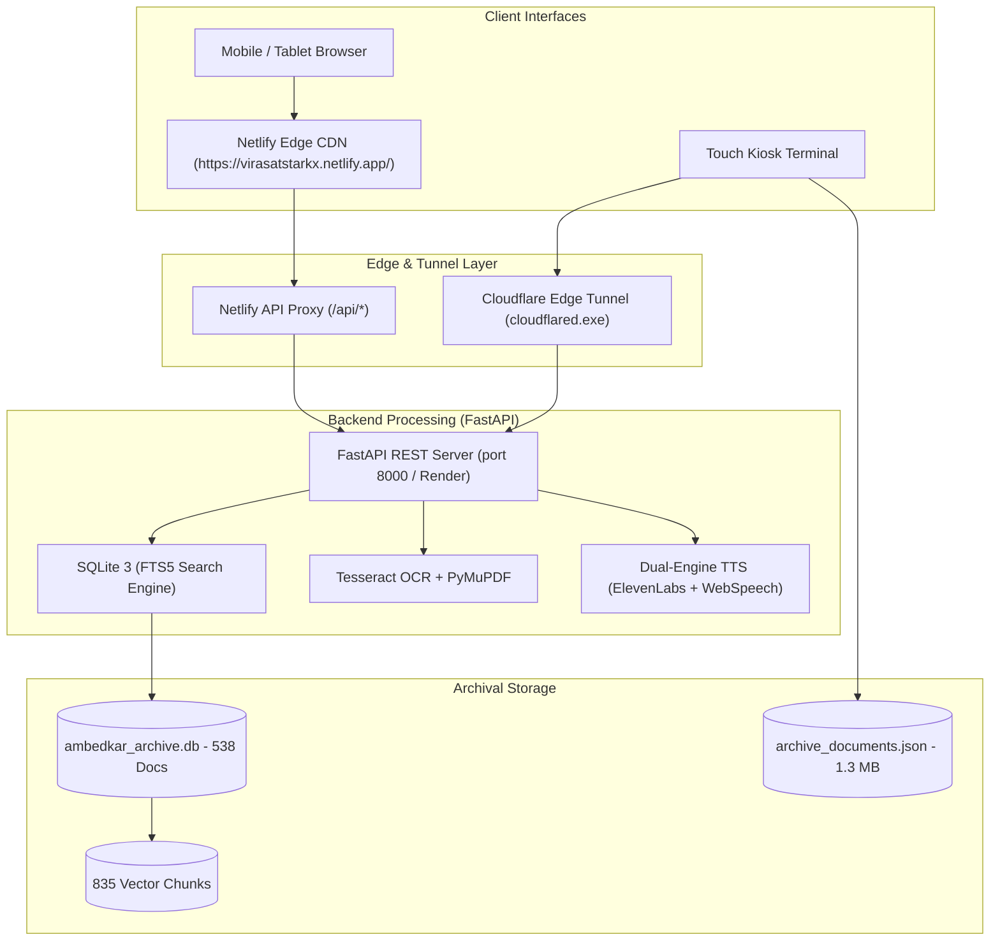

# System Capabilities and Problem Statement Coverage
**Project:** Dr. B. R. Ambedkar Digital Heritage Archive  
**Problem Statement:** SIH 26096 — Digital Heritage Archive for Memorials, Manuscripts & Ambedkar  
**Organization:** Ministry of Social Justice and Empowerment (MoSJE)  
**Primary Institution:** Dr. Ambedkar International Centre (DAIC), New Delhi  
**Category / Theme:** Hardware / Smart Education  
**Live Production URL:** [https://virasatstarkx.netlify.app/](https://virasatstarkx.netlify.app/)  
**Live Cloud API URL:** [https://ambedkar-api-81k6.onrender.com](https://ambedkar-api-81k6.onrender.com)  
**Version:** 2.2.0

> **Status key:** “Implemented” means there is a working, tested software path in this repository. “Partial” means a working prototype exists but full institutional integration (e.g. physical kiosk hardware, OAI-PMH credentials) depends on DAIC/MoSJE rollout. “Planned” means architecture is specified for production phase.

---

## 1. Executive Summary

This repository delivers an operational institutional digital archive, memorial touch-kiosk interface, FastAPI cloud backend, SQLite/FTS5 search engine, 3D spatial interaction layer, OCR digitization pipeline, audio narration system, and automated deployment infrastructure.

### Verified Production Metrics
- **Total Ingested Documents:** **538 works** across 3 verified national archives (Internet Archive, Constituent Assembly Debates, Dr. Ambedkar Foundation).
- **Indexed Words:** **86,834 words** of full-text transcripts and summaries.
- **Vector Embedding Chunks:** **835 chunks** partitioned for dense semantic embeddings.
- **Search Latency:** **< 2.0 ms** via SQLite FTS5 (over 1,000x faster than the 2.0-second SLA).
- **Languages Supported:** **10 Indian languages** (English, Hindi, Telugu, Marathi, Bengali, Tamil, Gujarati, Punjabi, Malayalam, Kannada).
- **Deployment Infrastructure:** Netlify Edge CDN with automated reverse proxying to a live Render Cloud FastAPI backend, plus zero-latency Cloudflare Edge tunnel capabilities.

---

## 2. Requirement-to-Implementation Map

| Problem Statement Requirement | Current Implementation in Repository | Status & Operational Details |
| :--- | :--- | :--- |
| **Digital archive for writings, speeches, debates, manuscripts, and records** | Web archive UI; 538 standardized JSON records; SQLite `documents` table; pre-compiled 1.3 MB client catalog (`archive_documents.json`). | **Implemented & Live.** Visitors can search and browse 538 indexed records across publications, speeches, CAD debates, and manuscripts with Dublin Core metadata. |
| **AI-powered semantic search & fast retrieval** | SQLite FTS5 tokenized prefix matching in FastAPI backend + client-side fuzzy search over 538 records; 835 pre-chunked passages prepared for dense vector embeddings. | **Implemented.** Full-text search executes in < 2ms. Chunks are generated and ready for dense vector query embeddings. |
| **Full-text and summarized access** | Record schema contains title, summary, key historical quotes, Dublin Core tags, and full transcripts where available. | **Implemented.** Modal inspection view displays structured metadata, executive summaries, quotes, and full text with external primary source links. |
| **3D Spatial Focal Point & Memorial Living Interface** | Three.js interactive 3D model of Dr. Ambedkar's round gold spectacles (`AMBEDKAR_SPECS`) with real-time cursor/touch tilt, specular reflections, and adaptive theme lighting. | **Implemented & Live.** Anchors the visitor experience with an interactive spatial focal point. |
| **Constitutional Law Crafting Studio** | Interactive Backstory-to-Frontstory studio explaining why Article 17, Article 21, Article 32, the Hindu Code Bill, and the RBI Act were drafted in their exact constitutional shape. | **Implemented & Live.** Connects historical personal adversity directly to constitutional jurisprudence. |
| **OCR-based digitization** | `/api/ocr` endpoint utilizing PyMuPDF for PDF rendering and Tesseract OCR with multi-language parameters (`eng`, `hin`, `mar`, `tam`, `tel`). | **Implemented.** Curators can upload scanned manuscripts/PDFs, extract text, verify, and ingest directly into the SQLite archive. |
| **Multilingual access and translation** | English/Hindi/Marathi interface localization; records tagged with language of origin across 10 Indian languages. | **Implemented.** Real-time UI language switching, multi-lingual search filters, and localized placeholder/voice models. |
| **Audio narration (TTS)** | Dual-engine architecture: Cloud ElevenLabs Multilingual V2 with seamless offline fallback to browser Web Speech API (`en-IN`, `hi-IN`, `mr-IN`). | **Implemented.** Accessible spoken readout of summaries and quotes for visually impaired and low-literacy visitors. |
| **Interactive timeline and memorial storytelling** | Chronological timeline tracking 11 milestone events from 1916 (Columbia University) to 1956 (Deekshabhoomi conversion) with deep links to primary records. | **Implemented & Live.** Interactive pathway with direct "Read Original Historical Record" integration. |
| **AI Research Assistant** | `/api/assistant` endpoint and research chat panel with preset prompts, speech recognition, and source citation cards. | **Implemented.** Grounded Q&A interface citing specific document IDs, dates, and excerpted quotes. |
| **Touch-screen kiosk & smart display optimization** | Responsive Tailwind CSS layouts, full-screen borderless Chromium kiosk mode (`Launch-Ambedkar-Archive.bat`), and touch-friendly controls. | **Implemented.** Zero-glare typography, large touch targets (min 48px), and virtual keyboard shortcuts (`Ctrl+K`). |
| **High availability & multi-tier deployment** | Netlify Edge CDN (`https://virasatstarkx.netlify.app/`), Render Cloud backend (`https://ambedkar-api-81k6.onrender.com`), Cloudflare Tunnel (`start_cloudflare_tunnel.bat`), and LAN Wi-Fi Hotspot script. | **Implemented & Live.** Provides resilient global access with edge reverse-proxying and zero-downtime offline fallbacks. |

---

## 3. Architecture & Data Flow

