# Feature Inventory & Specification — Dr. B.R. Ambedkar Digital Heritage Archive
**Problem Statement ID:** 26096 | **Theme:** Smart Education & Cultural Preservation  
**Deployment Target:** Dr. Ambedkar International Centre (DAIC), New Delhi  
**Live Production URL:** [https://virasatstarkx.netlify.app/](https://virasatstarkx.netlify.app/)  
**Live Cloud API URL:** [https://ambedkar-api-81k6.onrender.com](https://ambedkar-api-81k6.onrender.com)  
**Version:** 2.2.0

---

## 1. Feature Architecture Map

```mermaid
graph TD
    UI[Living Interface Web Portal] --> F1[1. Sub-Millisecond Hybrid Search]
    UI --> F2[2. Multi-Faceted Filter Hub]
    UI --> F3[3. 3D Spatial Lens: Ambedkar Spectacles]
    UI --> F4[4. Backstory-to-Frontstory Law Studio]
    UI --> F5[5. Chronological Heritage Timeline]
    UI --> F6[6. Constitutional AI Research Assistant]
    UI --> F7[7. Dual-Engine Audio Narration TTS]
    UI --> F8[8. Voice Speech-to-Text Input]
    UI --> F9[9. Document Deep Inspection Modal]
    UI --> F10[10. Obsidian & Parchment Dual Themes]
    UI --> F11[11. Ingestion Pipeline & OCR Studio]
    UI --> F12[12. Role-Based Access Control]
    UI --> F13[13. Complete 538-Record Client Catalog]
    UI --> F14[14. Cloudflare Edge Tunneling]
```

---

## 2. Comprehensive Feature Specifications

### Feature 1: Sub-Millisecond Full-Text Search (SQLite FTS5)
- **Category:** Core Retrieval Engine
- **Files Involved:** [`backend/database.py`](file:///C:/Users/NITESH/Downloads/MEORIAL_KIOSK/MODELS/PROTOTYPE/ambedkar01/ambedkar/backend/database.py), [`backend/app.py`](file:///C:/Users/NITESH/Downloads/MEORIAL_KIOSK/MODELS/PROTOTYPE/ambedkar01/ambedkar/backend/app.py) (`/api/search`), [`frontend/app.js`](file:///C:/Users/NITESH/Downloads/MEORIAL_KIOSK/MODELS/PROTOTYPE/ambedkar01/ambedkar/frontend/app.js) (`executeSearch()`).
- **Description:** Performs ultra-low-latency lexical keyword matching across titles, summaries, full transcribed text, and tags.
- **Performance:** Measured query latency is **0.5 ms to 1.8 ms**, outperforming the government's 2.0-second SLA target by over 1,000x.
- **Capabilities:** Tokenized query matching with prefix search (`term*`) across English, Hindi, and regional scripts.

---

### Feature 2: Multi-Faceted Archival Filtering
- **Category:** Search & Discovery
- **Files Involved:** [`frontend/index.html`](file:///C:/Users/NITESH/Downloads/MEORIAL_KIOSK/MODELS/PROTOTYPE/ambedkar01/ambedkar/frontend/index.html), [`frontend/app.js`](file:///C:/Users/NITESH/Downloads/MEORIAL_KIOSK/MODELS/PROTOTYPE/ambedkar01/ambedkar/frontend/app.js).
- **Description:** Allows visitors and researchers to refine 538 archival records across 3 independent taxonomies:
  1. **Language Filter:** All (10 Languages), English (418), Hindi (42), Telugu (27), Marathi (18), Bengali (11), Tamil (9), Gujarati (9), Punjabi (2), Malayalam (1), Kannada (1).
  2. **Document Type Filter:** Publications (426), Speeches (66), CAD Debates (22), Manuscripts (4), Historical Records (20).
  3. **Repository Source Filter:** Internet Archive (510), Constituent Assembly Debates (12), Dr. Ambedkar Foundation / BAWS (16).
- **Quick-Concept Chips:** One-tap shortcut buttons for recurring research topics: *CAD Debates, Annihilation of Caste, Directive Principles, Untouchability, Economics & RBI, Buddhism & Dhamma*.

---

### Feature 3: 3D Spatial Lens — Dr. Ambedkar's Round Spectacles (`AMBEDKAR_SPECS`)
- **Category:** Spatial 3D Interaction & Living Interface
- **Files Involved:** [`frontend/app.js`](file:///C:/Users/NITESH/Downloads/MEORIAL_KIOSK/MODELS/PROTOTYPE/ambedkar01/ambedkar/frontend/app.js) (`initSpecs3D()`, `updateSpecs3DTheme()`), [`frontend/index.html`](file:///C:/Users/NITESH/Downloads/MEORIAL_KIOSK/MODELS/PROTOTYPE/ambedkar01/ambedkar/frontend/index.html).
- **Description:** An interactive 3D hero artifact rendering Dr. B.R. Ambedkar’s iconic round, gold-rimmed spectacles in real-time WebGL using Three.js.
- **Interactions:**
  - Cursor-following and touch-drag rotation (`0.05` spring interpolation).
  - Procedural gold metallic materials (`MeshStandardMaterial` with metalness `0.92`, roughness `0.22`).
  - Translucent glass lenses with specular reflections.
  - Dynamic studio lighting: Ambient amber glow in Dark mode, warm tungsten in Light mode.

---

### Feature 4: Backstory-to-Frontstory Law Crafting Studio
- **Category:** Constitutional Education & Experiential Storytelling
- **Files Involved:** [`frontend/index.html`](file:///C:/Users/NITESH/Downloads/MEORIAL_KIOSK/MODELS/PROTOTYPE/ambedkar01/ambedkar/frontend/index.html), [`frontend/app.js`](file:///C:/Users/NITESH/Downloads/MEORIAL_KIOSK/MODELS/PROTOTYPE/ambedkar01/ambedkar/frontend/app.js) (`openLawDetail()`).
- **Description:** Directly connected to the 3D Spectacles, this studio visually breaks down why monumental laws were shaped through Dr. Ambedkar's perspective:
  - **Article 17 (Abolition of Untouchability):** Traced from the 1927 Mahad Water Satyagraha to direct civil penalty enactments.
  - **Article 21 (Protection of Life & Personal Liberty):** Deweyan pragmatism applied to Indian fundamental liberties.
  - **Article 32 (Constitutional Remedies):** Why rights without immediate prerogative writs are an empty promise.
  - **Hindu Code Bill (Women's Property & Marital Rights):** The ethical fight for gender equality leading to his 1951 resignation.
  - **Reserve Bank of India Act:** Roots in his London School of Economics doctorate treatise *The Problem of the Rupee*.

---

### Feature 5: Interactive Chronological Heritage Timeline
- **Category:** Educational & Memorial Storytelling
- **Files Involved:** [`backend/app.py`](file:///C:/Users/NITESH/Downloads/MEORIAL_KIOSK/MODELS/PROTOTYPE/ambedkar01/ambedkar/backend/app.py) (`/api/timeline`), [`frontend/app.js`](file:///C:/Users/NITESH/Downloads/MEORIAL_KIOSK/MODELS/PROTOTYPE/ambedkar01/ambedkar/frontend/app.js) (`loadTimeline()`).
- **Description:** Traces 11 pivotal milestones from 1916 to 1956 with deep links to primary scans and archival transcripts.

---

### Feature 6: Archival Research Assistant (Q&A Interface)
- **Category:** AI Research & Grounded Assistance
- **Files Involved:** [`backend/app.py`](file:///C:/Users/NITESH/Downloads/MEORIAL_KIOSK/MODELS/PROTOTYPE/ambedkar01/ambedkar/backend/app.py) (`/api/assistant`), [`frontend/app.js`](file:///C:/Users/NITESH/Downloads/MEORIAL_KIOSK/MODELS/PROTOTYPE/ambedkar01/ambedkar/frontend/app.js) (`handleAiSubmit()`).
- **Description:** Grounded archival research chat with preset prompts, speech recognition, and verifiable citations.

---

### Feature 7: Dual-Engine Audio Narration (Text-to-Speech)
- **Category:** Multimodal Accessibility
- **Files Involved:** [`backend/app.py`](file:///C:/Users/NITESH/Downloads/MEORIAL_KIOSK/MODELS/PROTOTYPE/ambedkar01/ambedkar/backend/app.py) (`/api/tts`), [`frontend/app.js`](file:///C:/Users/NITESH/Downloads/MEORIAL_KIOSK/MODELS/PROTOTYPE/ambedkar01/ambedkar/frontend/app.js) (`toggleAudioNarration()`).
- **Description:** Cloud ElevenLabs Multilingual V2 with seamless offline fallback to browser speech synthesis (`en-IN`, `hi-IN`, `mr-IN`).

---

### Feature 8: Voice Speech-to-Text Input
- **Category:** Hands-Free & Kiosk Accessibility
- **Files Involved:** [`frontend/app.js`](file:///C:/Users/NITESH/Downloads/MEORIAL_KIOSK/MODELS/PROTOTYPE/ambedkar01/ambedkar/frontend/app.js) (`initVoiceSearch()`).
- **Description:** Web Speech API recognition for multilingual voice queries in English, Hindi, and Marathi.

---

### Feature 9: Deep Document Inspection Modal
- **Category:** Curatorial & Scholarly Research
- **Files Involved:** [`frontend/index.html`](file:///C:/Users/NITESH/Downloads/MEORIAL_KIOSK/MODELS/PROTOTYPE/ambedkar01/ambedkar/frontend/index.html) (`#docModal`), [`frontend/app.js`](file:///C:/Users/NITESH/Downloads/MEORIAL_KIOSK/MODELS/PROTOTYPE/ambedkar01/ambedkar/frontend/app.js) (`openDocModal()`).
- **Description:** Comprehensive inspection modal displaying executive summaries, historical quotes, full transcripts, and Dublin Core metadata grids.

---

### Feature 10: Obsidian & Archival Parchment Dual Theme System
- **Category:** Visual Aesthetics & Ergonomics
- **Files Involved:** [`frontend/styles.css`](file:///C:/Users/NITESH/Downloads/MEORIAL_KIOSK/MODELS/PROTOTYPE/ambedkar01/ambedkar/frontend/styles.css), [`frontend/app.js`](file:///C:/Users/NITESH/Downloads/MEORIAL_KIOSK/MODELS/PROTOTYPE/ambedkar01/ambedkar/frontend/app.js) (`toggleTheme()`).
- **Description:**
  - **Obsidian Dark Mode:** `#040507` abyss dark with amber typography (`#f59e0b`), subtle card borders, and high contrast.
  - **Archival Parchment Light Mode:** `#f5f4ee` museum paper tone with dark slate typography and zero glare.

---

### Feature 11: Digitization & Ingestion OCR Studio
- **Category:** Archive Administration
- **Files Involved:** [`backend/ocr.py`](file:///C:/Users/NITESH/Downloads/MEORIAL_KIOSK/MODELS/PROTOTYPE/ambedkar01/ambedkar/backend/ocr.py), [`backend/app.py`](file:///C:/Users/NITESH/Downloads/MEORIAL_KIOSK/MODELS/PROTOTYPE/ambedkar01/ambedkar/backend/app.py) (`/api/ocr`, `/api/ingest`).
- **Description:** Scans PDFs and image uploads via PyMuPDF and Tesseract OCR with multi-language parameters (`eng`, `hin`, `mar`, `tam`, `tel`).

---

### Feature 12: Role-Based Curatorial Access Control
- **Category:** Institutional Security
- **Files Involved:** [`frontend/index.html`](file:///C:/Users/NITESH/Downloads/MEORIAL_KIOSK/MODELS/PROTOTYPE/ambedkar01/ambedkar/frontend/index.html), [`frontend/app.js`](file:///C:/Users/NITESH/Downloads/MEORIAL_KIOSK/MODELS/PROTOTYPE/ambedkar01/ambedkar/frontend/app.js).
- **Description:** Passcode verification gate protecting write operations:
  - Visitor: Read-only access to browse, search, and listen.
  - Student (`{STUDENT}`): Advanced analytical queries and cross-citations.
  - Researcher / Curator (`{RESEARCHER}`): Unlocks ingestion and OCR pipeline.

---

### Feature 13: Complete 538-Record Client-Side Catalog
- **Category:** High-Availability Resilience
- **Files Involved:** [`frontend/archive_documents.json`](file:///C:/Users/NITESH/Downloads/MEORIAL_KIOSK/MODELS/PROTOTYPE/ambedkar01/ambedkar/frontend/archive_documents.json), [`frontend/app.js`](file:///C:/Users/NITESH/Downloads/MEORIAL_KIOSK/MODELS/PROTOTYPE/ambedkar01/ambedkar/frontend/app.js) (`loadLocalArchiveCatalog()`).
- **Description:** A pre-compiled 1.3 MB static catalog containing all 538 historical records, enabling instant search, filtering, and pagination (30 records per page) with zero reliance on cloud container spin-up.

---

### Feature 14: Cloudflare Edge Tunneling & Cloud Hybrid Setup
- **Category:** Infrastructure & DevOps
- **Files Involved:** [`start_cloudflare_tunnel.bat`](file:///C:/Users/NITESH/Downloads/MEORIAL_KIOSK/MODELS/PROTOTYPE/ambedkar01/ambedkar/start_cloudflare_tunnel.bat), [`netlify.toml`](file:///C:/Users/NITESH/Downloads/MEORIAL_KIOSK/MODELS/PROTOTYPE/ambedkar01/ambedkar/netlify.toml), [`auto_deploy_and_check.py`](file:///C:/Users/NITESH/Downloads/MEORIAL_KIOSK/MODELS/PROTOTYPE/ambedkar01/ambedkar/auto_deploy_and_check.py).
- **Description:** Direct integration with Cloudflare Edge tunnels (`cloudflared`) allowing local kiosk servers to be accessed globally with sub-second latency, while Netlify provides static edge caching and automated proxying.
